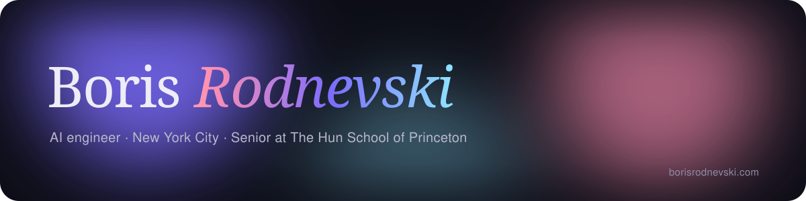

  
  
  

### Hey, I'm Boris 👋

I'm an AI engineer from New York City and a senior at The Hun School of Princeton. I build with large language models, I like breaking things to understand how they stay secure, and I read philosophy to think more clearly.

- 🧠 **Right now:** building AI agents that use tools to get real work done
- 🔐 **Into:** AI engineering, cybersecurity, and clean, fast frontends
- 📖 **Reading:** *The Count of Monte Cristo* by Alexandre Dumas
- 🌐 **Site:** [borisrodnevski.com](https://borisrodnevski.com), with a working bookshelf of everything I've read

### Toolkit

  

| Skill | Level |
| --- | --- |
| AI engineering (agents, tool use, RAG, evals) | ██████████ 10/10 |
| Python / JavaScript | █████████░ 9/10 |
| TypeScript / Java / React / Node.js | ████████░░ 8/10 |
| C++ / PyTorch | ███████░░░ 7/10 |

### Things I've built

| Project | What it is | Stack |
| --- | --- | --- |
| **STORM** | The all-in-one Discord bot for ClashLine | JavaScript, discord.js |
| **[Discord Bot Template](https://github.com/notKilo/Discord-Bot-Template)** | Open-source starter to spin up a Discord bot in minutes | JavaScript |
| **Sunset Client** | Custom Java game client with its own UI and modules | Java |
| **borisrodnevski.com** | My personal site: live aura, 3D bookshelf, NYC clock | HTML, CSS, JS |
| **C++ arcade** | Snake, Pong and a login system, from scratch | C++ |

### Stats

  
  

---

<i>"Wait and hope."</i> · Alexandre Dumas, <i>The Count of Monte Cristo</i>

